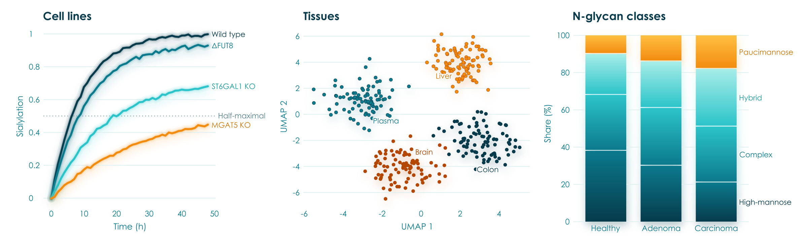
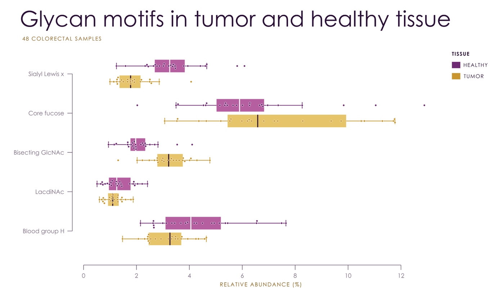
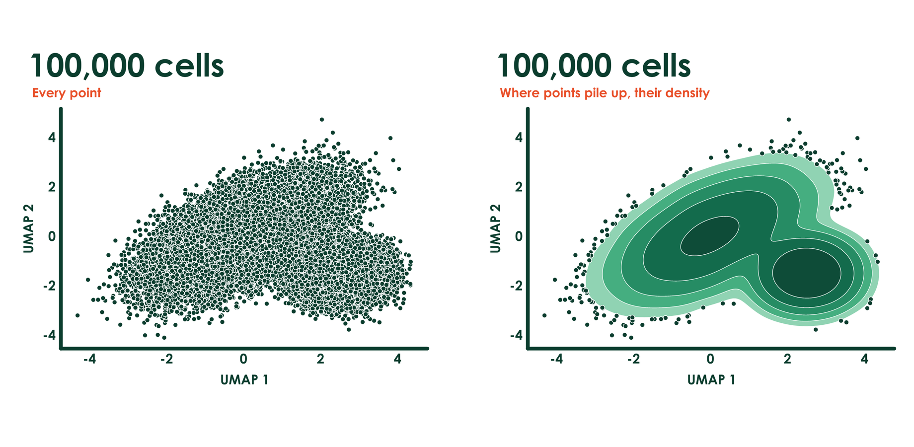
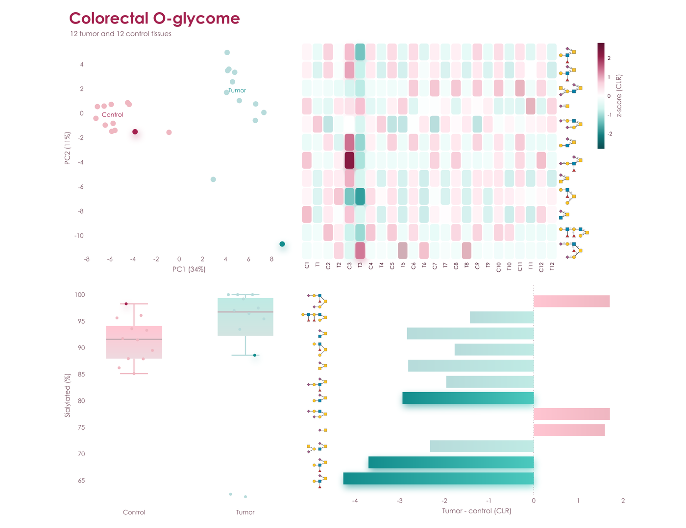
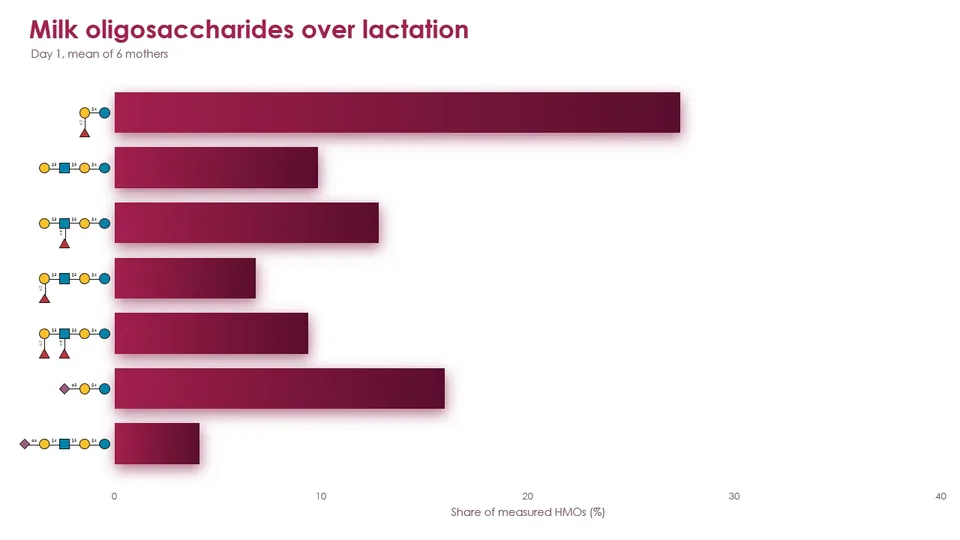
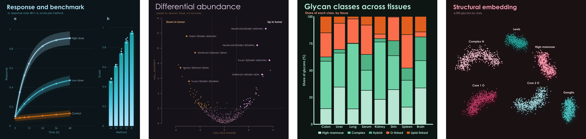

<h1 align="center">viscose</h1>

<p align="center"><strong>Scientific plots that are pieces of art.</strong><br>
Pick a palette. It brings its own colors, type, axes, and special effects.</p>

<p align="center"></p>

```bash
pip install viscose   # numpy and glycorender are all it needs, clustermaps included
```

## One word changes everything

```python
import viscose as vc

fig, ax = vc.subplots(palette = 'aura')
fig.suptitle('Differential abundance', 'Tumor vs. healthy tissue, 412 glycans')
ax.scatter(x, y, hue = direction)
ax.axhline(2)
ax.set_xlabel('log_{2} fold change')
ax.set_ylabel('-log_{10} adjusted p')
fig.save('volcano.pdf')
```

Same data, same code, and only `palette` changes. Spheres become rings, gradients become solid shapes, hairline axes become
heavy rounded ones, and titles go from light and wide to bold and tight. No styling code, no `rcParams`, and no theme files.

<p align="center"></p>

## Four palettes, four personalities

Each palette has two hues in four shades, and effects to match. Few colors, in shades of those few colors, on white: figures
that look composed in a paper and striking on a slide.

<p align="center"></p>

### `lumen`: peacock and marigold

Gradients run through the marks, points are glossy spheres, lines glow, and everything rests on soft shadows.

<p align="center"></p>

### `couture`: plum and gold

Hairline axes held away from the data, slender needle bars, large light titles, and spaced capitals.

<p align="center"></p>

### `poster`: forest and vermilion

Heavy rounded axes, big bold type, and thick solid marks cut apart by crisp white gaps.

<p align="center"></p>

### `aura`: burgundy and teal

Marks float on soft shadows in their own color, above rounded heatmap cells, with no axis lines at all.

<p align="center"></p>

## Out of the box

The same data and the same labels, with no styling on either side: matplotlib and seaborn on the left, viscose on the right.

<p align="center"></p>

## Glycans in your plots

viscose shares its renderer with [glycowork](https://github.com/BojarLab/glycowork)'s GlycoDraw, so glycans are glyphs: real
SNFG drawings that stand wherever a label does, laid out by the same engine as the rest of the figure and as sharp in PNG, PDF,
and SVG. Tick labels, annotations, legend entries, and clustermap rows all take them. Each drawing's reducing end sits on its
tick or beside its point. Tick drawings scale together to fit between their neighbors, crowded rows stagger into two
columns, and the page grows before any label is left out. Annotations with `spread = True` find open room around their
points, clear of the data and of each other, at the largest size that room allows, with a hairline where they stand apart.
On a dark page they become die-cut stickers, and a glycan at heatmap size takes 1.5 kB of SVG.

```python
ax.barh(glycans, abundance)
ax.tick_params('y', glyphs = 'glycan')
ax.annotate('Neu5Ac(a2-6)Gal(b1-4)GlcNAc', (x, y), glyph = 'glycan', spread = True)
ax.legend('right', glyphs = 'glycan')
vc.clustermap(table, glyphs = 'glycan')
```

Labels that name no glycan, such as a sample, stay text. Any drawing can be a glyph: `vc.register_glyphs(name, maker)` takes
a function that returns SVG for a label, for chemical structures, protein domains, or icons of your own.

<p align="center"></p>

## Everything you reach for

`hue`, `style`, and `size` take one value per point, as in seaborn. Each color's points are named right where they
lie, and shapes and sizes get a legend.

```python
ax.scatter(x, y, hue = stage, style = source, size = abundance,
           hue_label = 'Stage', style_label = 'Source', size_label = 'Abundance')
ax.text(0.02, 0.98, 'F = 4.2\np = 0.003', axes_fraction = True, va = 'top')
```

<p align="center"></p>

### Labels where the data are

Legends make the reader look away and match colors. viscose names each series beside it instead, in its own color: at
the end of a line, moving labels apart exactly as little as it takes, with a hairline to each one that moved; on the
free spot nearest a group of points, clear of the other groups; at the right of stacked bars; over a histogram's peak;
and along reference lines. The plot makes room for the labels, the axis limits stay with the data, and every label
stands out from the page as far as text has to, even for the palest line. Groups of points that mingle have no place of their own,
so they keep a legend, as does anything else without one, such as plain bars. `ax.legend('right')` or any other place
puts everything into one legend.

```python
for name, curve in curves.items():
    ax.plot(t, curve, label = name)
ax.axhline(0.5, label = 'Half-maximal')
ax.legend()
```

<p align="center"></p>

Group comparisons show every sample. `boxplot` spreads each value as a point over a paler box, `violinplot` draws each group's density with its quartiles inside, or its points spread as wide as the density, and `stripplot` gives the points alone. `bracket` marks a difference between two groups with a p-value or stars, above the data between them; several stack by themselves, narrower ones lower, and the axis grows to hold them. `sharex` and `sharey` put panels on one scale, with tick labels on the outer ones and the plot areas lined up.

```python
fig, (a, b) = vc.subplots(1, 2, palette = 'lumen', sharey = True)
a.boxplot({'Healthy': healthy, 'Adenoma': adenoma, 'Carcinoma': carcinoma, 'Metastasis': metastasis})
a.bracket('Healthy', 'Adenoma', 0.003)
a.bracket('Healthy', 'Carcinoma', '***')
b.violinplot(core_fucose)
```

<p align="center"></p>

Groups within groups come straight from a tidy table, as seaborn takes them: name the columns, and `hue` sets each category's boxes, violins, or strips side by side under one legend. Long names read across the page, where the plot turns by itself when x holds the numbers, or with `orient = 'h'`. `swarm = True` packs the points side by side so that none overlap, which suits 20 to 100 samples a group, and `names` tells slate's console which sample sits under the mouse. `bracket(('Core fucose', 'Healthy'), ('Core fucose', 'Tumor'), 0.01)` compares two groups of a hue, `density_norm = 'width'` keeps every violin readable beside a narrow one, and panels with `sharex` or `sharey` share their categories, so each group holds one place in all of them, whatever order each panel lists it in.

```python
fig, ax = vc.subplots(palette = 'couture')
ax.boxplot(df, x = 'abundance', y = 'motif', hue = 'tissue', swarm = True, names = 'sample')
```

<p align="center"></p>

Clustermaps come with both dendrograms and a color bar. Hand over a DataFrame and it brings its own labels. viscose clusters by itself, with scipy's seven linkage methods, its common metrics, or a function of your own, and orders the leaves so that neighbors are as alike as the tree allows. That order is the exact optimum, which scipy's `optimal_leaf_ordering` reached in 158 of 300 small trees checked by brute force, and it comes faster: 0.6 s against scipy's 2.8 s for 1,000 rows, and 3.2 s against 20 s for 2,000. `vc.linkage` gives the same trees in scipy's format.

```python
fig, heat = vc.clustermap(df, palette = 'aura', title = 'Glycan abundance by tissue', colorbar_label = 'z-score')
```

<p align="center"></p>

## Every point, every reader, every press

Where points pile up past telling them apart, viscose maps their density instead: smooth bands in their color's own
shades, from the palest at the edge to the strongest at the core, each set apart by a hairline of the page, and every
point kept where the data are sparse. 100,000 points read as a map of where the data lie, outliers stay in view, and the
bands are true vector shapes, crisp at any zoom: 100,000 points take 45 kB of PDF, and a real LC-MS map of 152,000 peaks
draws as PNG in 0.45 s where every point took 3.2 s. `density = False` keeps every point.

<p align="center"></p>

Type is set as a typesetter would. Numbers on axes and color bars take tabular figures and line up on their decimal
points, and every other line of text lines up by its ink rather than its letters' boxes, so a title stands flush with
its axis by eye. At layout, every text and mark is checked against the page with APCA, the contrast measure of WCAG 3,
and the colors that tell groups apart are checked as readers with protanopia, deuteranopia, and tritanopia see them. A
shade that falls short takes the nearest shade of its own hue that passes, and `fig.adjusted` lists each change.

For print, `fig.save('figure.pdf', press = True)` writes a PDF/X-4 in CMYK for web offset on coated paper (CGATS TR 001,
SWOP), with its ICC profile as the output intent, and `press = 'FOGRA39.icc'` takes a printer's or a journal's own
profile. Colors the press cannot reach keep their lightness and hue and give up only the chroma they must, so Aura's
hues print as Aura's hues. `fig.save('proof.png', press = True)` shows on screen how the page prints, and
`vc.Press().gamut('aura')` gives each shade's CIEDE2000 from screen to press.

```python
ax.scatter(umap[:, 0], umap[:, 1])
fig.save('figure.pdf', press = True)
fig.save('proof.png', press = True)
```

| | |
|---|---|
| **Plots** | `plot`, `step`, `scatter`, `bar`, `barh`, `stacked_bar`, `hist`, `fill_between`, `errorbar`, `boxplot`, `violinplot`, `stripplot`, `contour`, `stem`, `hlines`, `vlines`, `arrow`, `rectangle`, `heatmap`, `ridgeline`, `dendrogram`, `axhline`, `axvline`, `axline`, `axhspan`, `axvspan`, `image`, and `vc.clustermap` |
| **Markers** | `o`, `s`, `D`, `^`, `v`, `>`, `<`, `X`, `P`, `*`, `h`, and `p`, all with the palette's effects |
| **Annotation** | `text`, `annotate`, `bracket`, `legend`, and `colorbar`, with `_{sub}` and `^{super}` in any text; `legend()` names every line, group of points, stacked bar, histogram, and reference line where it is, and `annotate(spread = True)` does the same for any text, moving labels apart exactly as little as it takes, with a hairline to each one that moved; `annotate(y_fraction = True)` holds a label or a drawing in a band of the axes through every zoom, such as a fragment over its peak |
| **Pages** | `vc.Figure(183, 120, unit = 'mm')` is a journal page, `fig.add_axes((x, y, w, h), unit = 'mm')` places a panel from its top left, and `fig.letter(x, y, 'a', 'Heading')` and `fig.text` write panel letters and any other text on the page; `vc.subplot_mosaic('abc;ddd')` lets axes span cells of a grid |
| **Axes** | `set_xscale` takes `linear`, `log`, `sqrt`, or any pair of functions; `set_ylim(0, None)` fixes one end and leaves the other to the data and to any brackets; `fmt` on `set_xticks` and `set_yticks` writes the ticks, as `'{:.0%}'` or a function; `tick_params` sets each axis's tick length, pad, label size, and labels, puts x labels on top, or keeps labels exactly as set; `emphasis` sets chosen tick labels bold in a color; `set_spines` shows or hides each axis line |
| **Layout** | Colliding tick labels turn and thin themselves, labels move to the side with room, legends wrap, long axis names shrink, and the page grows for anything that needs it; `vc.subplots(sharex = True, sharey = 'row')` shares limits, scales, and ticks across all panels, rows, or columns, as in matplotlib |
| **Output** | `fig.save` writes PNG, PDF, SVG, or PowerPoint from the same geometry, with marks, gradients, and text as real vectors in PDF and SVG, native shapes and editable text in PowerPoint, and with `press` a CMYK PDF/X-4 for print or a soft proof; `interactive = True` gives an SVG hover text and highlighting linked across panels; `vc.deck` makes a talk whose slides Morph into each other; `scatter(rasterized = True)` makes tens of thousands of points one image there, as 100,000 points take 1.7 MB of SVG in place of 17.6 MB, with axes and text still vector; `fig.to_rgba` gives the pixels and `fig.display_list` the drawing operations, for showing a figure in a window; `viscose.qt`, with `pip install "viscose[qt]"`, is that window: PySide6 widgets that paint a figure about ten times as fast as the rasterizer, with pan, zoom, and mouse targets |
| **Positions** | `fig.layout` settles the page, and `ax.page` and `ax.data` turn data positions into page points and back, and `ax.boxes()` gives the page boxes of everything drawn, for placing things yourself clear of it or answering a mouse, and `ax.hidden(artist)` which points a density field holds |
| **Display** | `fig.show()` works inline in Jupyter and slate, and in the system's image viewer from a terminal, with CI and coding agents kept silent |
| **SVG hooks** | `gid` on `arrow` and `scatter` names elements for hover text and scripting |
| **Names** | `names` on `scatter`, `boxplot`, `stripplot`, and `violinplot` labels each point, on `stem` and `vlines` each peak, and on `heatmap` each row and column, which draws nothing but lets slate show what is under the mouse, `highlight` find them, and an interactive SVG light up the same sample in every panel |
| **Palettes** | `fig.in_palette('aura')` gives the same figure in another palette, exactly as if it had been drawn in that one, shades taken from `fig.pal` included |
| **Source** | Every file `fig.save` writes carries the figure's own calls and data, a few kB of JSON, and `vc.open('fig3.pdf')` brings the figure back from that file alone: `vc.open('fig3.pdf', 'couture')` in another palette, `vc.open('fig3.pdf', 'aura-dark')` dark, `vc.open('fig3.pdf', size = (89, 70), unit = 'mm')` at a journal's column width, exactly as if drawn that way, and the numbers are there for anyone to read, as the PDF's attachment `figure-source.json`; `source = False` leaves it out |
| **State** | None hidden: a figure is an object, with no current figure and nothing to close |

## Focus in shades, figures that answer the mouse

`highlight` keeps what matters in full shade and lets everything else recede toward the page, each in its own hue, so
the emphasis comes from shade, never from a new color. It names samples, groups, categories, or a heatmap's rows and
columns; the focus draws over the context, which casts no shadow, and legends and labels follow.
`ax.highlight(['Day 4'])` does the same for every line on an axes.

```python
pca.scatter(pc1, pc2, hue = condition, names = samples, highlight = ['C3', 'T3'])
heat.heatmap(z, xticklabels = samples, yticklabels = glycans, highlight = ['C3', 'T3'])
bars.barh(glycans, change, highlight = largest)
```

<p align="center"></p>

`fig.save('figure.svg', interactive = True)` writes an SVG that answers the mouse, with a few lines of script and no
library. Over a point, bar, box, cell, line, or tick label, a box in the palette's colors says what it is and gives its
values, and everything of the same name lights up in every panel while the rest of each fades: a sample's point in the
PCA, its column in the heatmap, and its point over the boxes; a glycan's row and its bar, from its drawing on either
axis; a group from its label. Interactive figures on one page light up together. Printed, as an ``, or in an
editor, the file is the figure as drawn, pixel for pixel. [The figure above](https://github.com/BojarLab/viscose/raw/main/examples/readme/linked.svg),
in Poster, is one: save it and open it in a browser.

## Talks that move

`fig.save('figure.pptx')` writes a slide of PowerPoint's own shapes. Bars, points, lines, and cells are shapes you can
click, text stays text in the palette's font, ready to edit in place, and Aura's soft shadows and Lumen's gradients are
PowerPoint's own effects: PowerPoint renders every gallery figure in all eight palettes, light and dark, within 1 to 5.5
levels of 255 of viscose's own pixels, on average. `vc.deck([fig1, fig2, fig3], 'talk.pptx')` puts figures on
consecutive slides with Morph between them. Every shape is named after what it draws, by its axes, its series, and its
own category, point name, or row and column, and Morph carries each shape to the shape of the same name on the next
slide: bars grow to their new heights, points travel to their new places, ticks slide along their axes, and a heatmap's
cells fly to where clustering puts them. Draw the next figure with the same calls on new data, and the talk animates
itself, with no video files.

The palette becomes the deck's theme. Its two hues are the theme's first two accents, and every shade, gradient, cell,
and shadow is its hue's accent at the shade's own lightness; its ink, muted text, page, and guides are the theme's text
and background colors, and its font the theme's. A deck's own theme, or PowerPoint's Design tab, recolors the figure in
the new hues while every shade keeps its lightness, so contrast and order hold, and glycan drawings keep SNFG's colors.

```python
figs = []
for day in (1, 4, 14):
    fig, ax = vc.subplots(figsize = (13.333, 7.5))
    ax.barh(glycans, shares.loc[day])
    ax.tick_params('y', glyphs = 'glycan')
    figs.append(fig)
vc.deck(figs, 'talk.pptx')
```

Below is [such a deck](https://github.com/BojarLab/viscose/raw/main/examples/readme/talk.pptx) as PowerPoint plays it:
human milk oligosaccharides on days 1, 4, and 14 of lactation, then the most abundant colorectal N-glycans in sample
order and clustered. Five widescreen slides take 0.2 s and 45 kB.

<p align="center"></p>

## Light and quick

No compiled plotting stack, no backends, and no font cache. For vector output, viscose is often many times faster than
matplotlib and seaborn, and its files can be far smaller. At 300 dpi, in Poster:

| | matplotlib and seaborn | viscose |
|---|---|---|
| Dependencies | Nine extra packages, 42.5 MB | numpy and glycorender, with 0.15 MB of its own code |
| Clustermap, 300 x 100, PDF | 1.57 s, 587 kB | **0.02 s, 79 kB** |
| Clustermap, 300 x 100, SVG | 1.40 s, 5,943 kB | **0.02 s, 182 kB** |
| Clustermap, 26 x 16, PDF | 0.11 s, 22 kB | **0.02 s**, 26 kB |
| Three lines with a legend, PDF | 0.03 s, 12 kB | **under 0.01 s**, 13 kB |
| Scatter, 100,000 points, PDF | 1.64 s, 1,523 kB | **0.13 s, 45 kB** |
| Bars, PNG | 0.19 s, 43 kB | **0.20 s, 38 kB** |
| Three lines with a legend, PNG | 0.27 s, 393 kB | 0.43 s, **370 kB** |
| Scatter, 412 points, PNG | 0.23 s, 147 kB | 0.27 s, 180 kB |

PNGs keep pace with matplotlib's compiled rasterizer, at most about 1.6 times its time in Poster, and pack smaller wherever a plot
has fills and lines. The soft shadows of Lumen and Aura are computed while the page draws. To rerun the full comparison, wins and losses alike, use
[benchmarks/compare_matplotlib.py](https://github.com/BojarLab/viscose/blob/main/benchmarks/compare_matplotlib.py).

## Make it yours

`vc.set_palette('aura')` changes the default for every figure, and `vc.set_palette(None)` hands the choice back. A library that builds on viscose calls `vc.default_palette('aura')`
instead, which gives way to the choice of whoever uses it. In any palette, refer to its shades as `a0` to `a3` and `b0` to `b3`, dark
to pale, or as `ink`, `muted`, `faint`, and `paper`; hex and CSS color names work too. `fig.pal.groups(3, 2)` gives categories grouped by hue,
here three shades of one and two of the other, and `fig.pal.contrast(n)` alternates between the hues for categories that have to stand
apart, as `scatter(hue = ...)` does.

A palette of your own is two hues, three text colors, and whichever effects you like:

```python
vc.register_palette(vc.Palette('midnight', ['#14213D', '#27477E', '#5C85C5', '#C4D5EE'], ['#8F5B00', '#D08C00', '#F2B83B', '#FBE5B0'],
                               '#14213D', '#5A6478', '#E6EAF1', point = 'sphere', bar = 'deep', shadow = 0.4))
fig, ax = vc.subplots(palette = 'midnight')
```

A palette can also bring a house or journal font (`font = ('Arial', 'arial.ttf', 'arialbd.ttf')`), a true minus sign (`minus = '−'`), `spacing` that tightens every gap, pad, and legend row for six-point type, and color scales of its own (`sequential_stops`, `diverging_stops`), so a journal's figure style is one palette.

Century Gothic is used where it is installed, and glycorender's bundled Comfortaa elsewhere.

### Dark pages

Every palette has a dark version, for an app's or a notebook's dark theme. `vc.dark_mode()` turns every palette dark for new figures,
whether chosen by name, passed in, or a library's default, and `vc.dark_mode(paper = '#1E1E1E')` sets them on the theme's own
surface. `palette = 'lumen-dark'` names one directly, and `pal.dark()` makes one from any palette, your own included. Each color keeps
its hue and mirrors its lightness, so the shade that stood out most on white stands out most on the dark page, and oranges and golds
stay warm. Spheres keep their light from above, Lumen's lines glow brighter, and Aura's soft shadows become a glow in each mark's own
color. `fig.save('plot.png', background = None)` leaves the page transparent, so a figure sits on any dark surface.

One SVG carries both: `fig.save('plot.svg', themes = True)` writes the figure and its dark version as one drawing whose
colors follow the reader's light or dark mode, on a website, on GitHub, or in docs, with no second export. Only the
colors that differ are written twice, as CSS custom properties under a `prefers-color-scheme` rule: over the gallery,
the file is 1 to 10% larger than one theme alone in Couture and Poster, and 5 to 70% in Lumen and Aura, whose
gradients and shadows turn too. Rendered in Chromium, each theme is pixel for pixel the SVG of that theme alone, and an
editor that reads no CSS sees the light page. `themes = '#0D1117'` sets the dark page to a site's own background. The figure
below is one such file: turn your system's dark mode on, and it turns with it.

<p align="center"></p>

<p align="center"></p>

A palette's `paper` is the color of its page, white unless you say otherwise, and every format draws on it. A palette made for a dark
page takes a light `ink` and orders its shades from the strongest against the page to the faintest, so that rings, halos, and scales
follow; `dark_settings` sets a palette's dark shades by hand, such as `dark_settings = {'b': [...]}`.

## More

[examples/gallery.py](https://github.com/BojarLab/viscose/blob/main/examples/gallery.py) draws eight standard figures in every palette, [examples/features.py](https://github.com/BojarLab/viscose/blob/main/examples/features.py)
draws one sheet of features per palette, and [examples/readme_figures.py](https://github.com/BojarLab/viscose/blob/main/examples/readme_figures.py) draws every image on this page.
