<h1 align="center">viscose</h1>

<p align="center"><strong>Scientific plots that are pieces of art.</strong><br>
Pick a palette. It brings its own colors, type, axes, and special effects.</p>

<p align="center">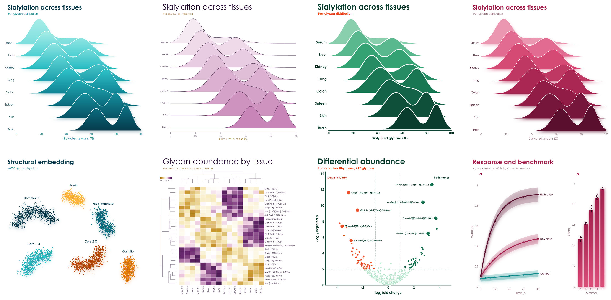</p>

```bash
pip install viscose   # numpy and glycorender are all it needs, clustermaps included
```

## One word changes everything

```python
import viscose as vc

fig, ax = vc.subplots(palette = 'aura')
fig.suptitle('Differential abundance', 'Tumor vs. healthy tissue, 412 glycans')
ax.scatter(x, y, hue = direction)
ax.axhline(2)
ax.set_xlabel('log_{2} fold change')
ax.set_ylabel('-log_{10} adjusted p')
fig.save('volcano.pdf')
```

Same data, same code, and only `palette` changes. Spheres become rings, gradients become solid shapes, hairline axes become
heavy rounded ones, and titles go from light and wide to bold and tight. No styling code, no `rcParams`, and no theme files.

<p align="center">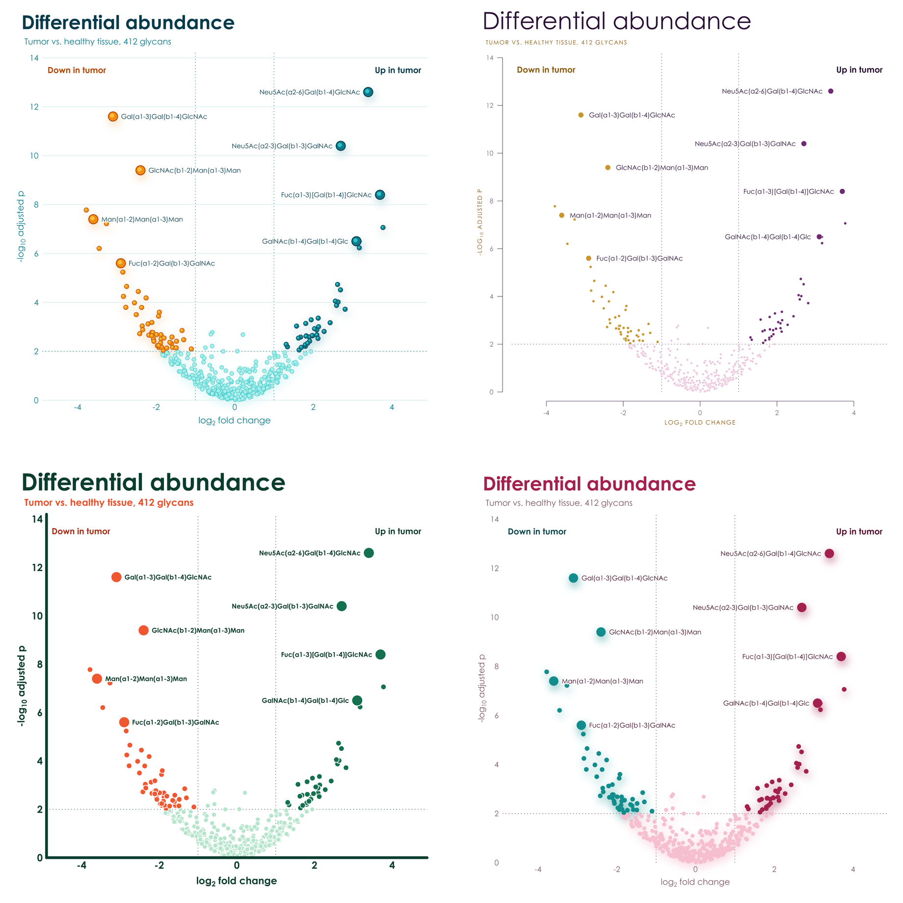</p>

## Four palettes, four personalities

Each palette has two hues in four shades, and effects to match. Few colors, in shades of those few colors, on white: figures
that look composed in a paper and striking on a slide.

<p align="center">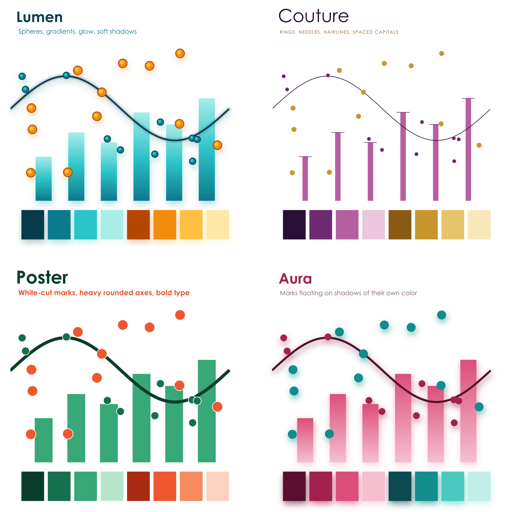</p>

### `lumen`: peacock and marigold

Gradients run through the marks, points are glossy spheres, lines glow, and everything rests on soft shadows.

<p align="center">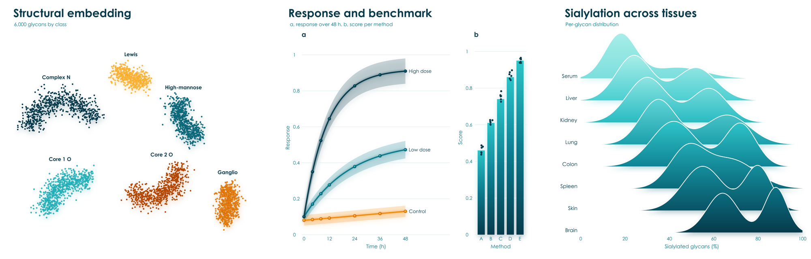</p>

### `couture`: plum and gold

Hairline axes held away from the data, slender needle bars, large light titles, and spaced capitals.

<p align="center">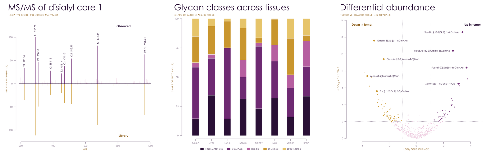</p>

### `poster`: forest and vermilion

Heavy rounded axes, big bold type, and thick solid marks cut apart by crisp white gaps.

<p align="center">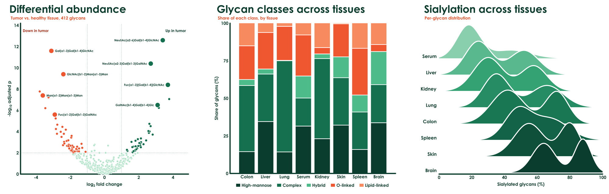</p>

### `aura`: burgundy and teal

Marks float on soft shadows in their own color, above rounded heatmap cells, with no axis lines at all.

<p align="center">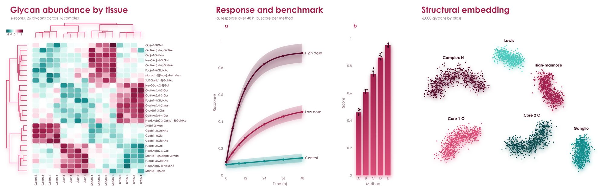</p>

## Out of the box

The same data and the same labels, with no styling on either side: matplotlib and seaborn on the left, viscose on the right.

<p align="center">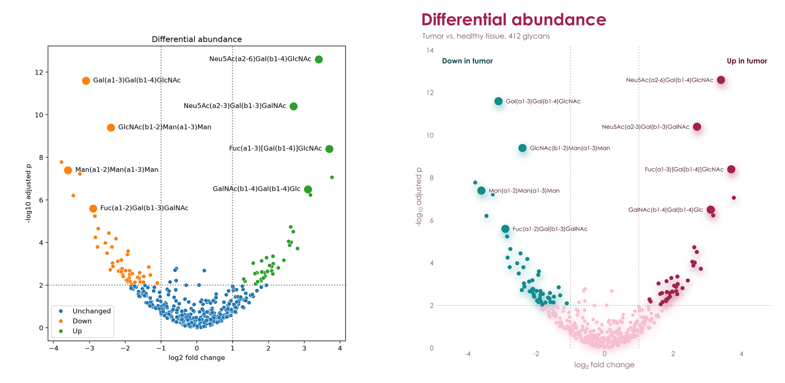</p>

## Glycans in your plots

viscose shares its renderer with [glycowork](https://github.com/BojarLab/glycowork)'s GlycoDraw, so a plot can carry real SNFG
drawings as sharp as the rest of the figure, in PNG, PDF, and SVG.

```python
from glycowork.motif.draw import annotate_figure

ax.annotate('Neu5Ac(a2-6)Gal(b1-4)GlcNAc', (x, y), offset = (12, 0), svg_label = True)
fig.save('volcano.svg')
annotate_figure('volcano.svg', filepath = 'volcano.pdf', compact = True)
```

<p align="center">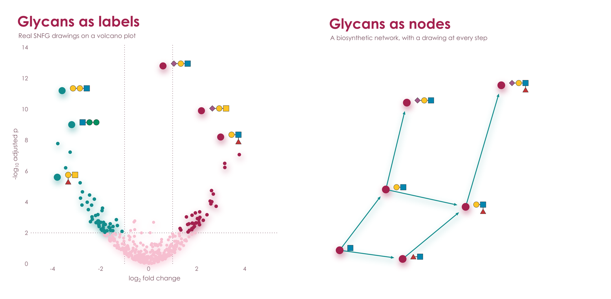</p>

## Everything you reach for

`hue`, `style`, and `size` take one value per point and build the legend for you, as seaborn does.

```python
ax.scatter(x, y, hue = stage, style = source, size = abundance,
           hue_label = 'Stage', style_label = 'Source', size_label = 'Abundance')
ax.text(0.02, 0.98, 'F = 4.2\np = 0.003', axes_fraction = True, va = 'top')
```

<p align="center">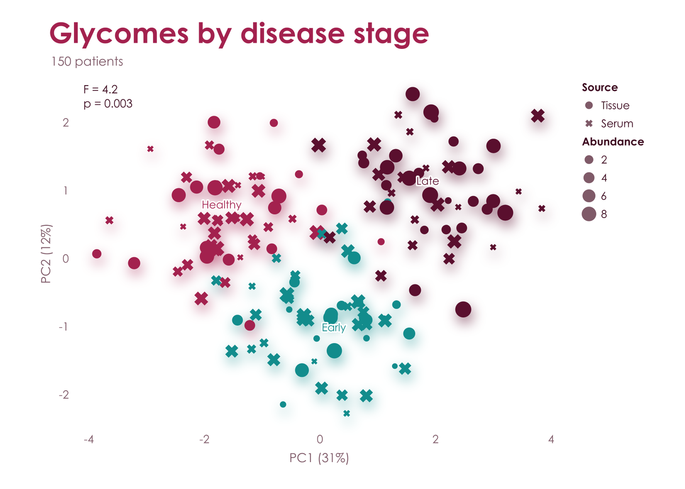</p>

Group comparisons show every sample. `boxplot` spreads each value as a point over a paler box, `violinplot` draws each group's density with its quartiles inside, or its points spread as wide as the density, and `stripplot` gives the points alone. `sharex` and `sharey` put panels on one scale, with tick labels on the outer ones and the plot areas lined up.

```python
fig, (a, b) = vc.subplots(1, 2, palette = 'lumen', sharey = True)
a.boxplot({'Healthy': healthy, 'Adenoma': adenoma, 'Carcinoma': carcinoma, 'Metastasis': metastasis})
b.violinplot(core_fucose)
```

<p align="center">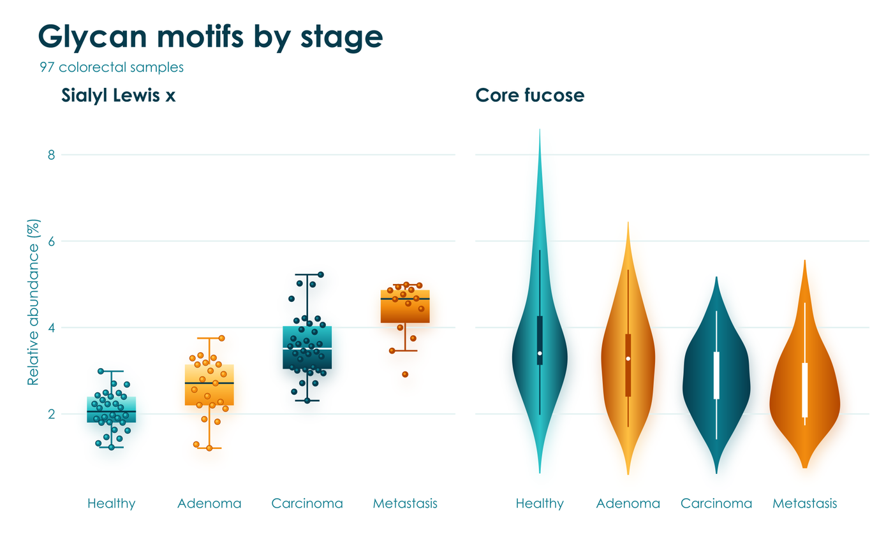</p>

Clustermaps come with both dendrograms and a color bar. Hand over a DataFrame and it brings its own labels. viscose clusters by itself, with scipy's seven linkage methods, its common metrics, or a function of your own, and orders the leaves so that neighbors are as alike as the tree allows. That order is the exact optimum, which scipy's `optimal_leaf_ordering` reached in 158 of 300 small trees checked by brute force, and it comes faster: 0.6 s against scipy's 2.8 s for 1,000 rows, and 3.2 s against 20 s for 2,000. `vc.linkage` gives the same trees in scipy's format.

```python
fig, heat = vc.clustermap(df, palette = 'aura', title = 'Glycan abundance by tissue', colorbar_label = 'z-score')
```

<p align="center">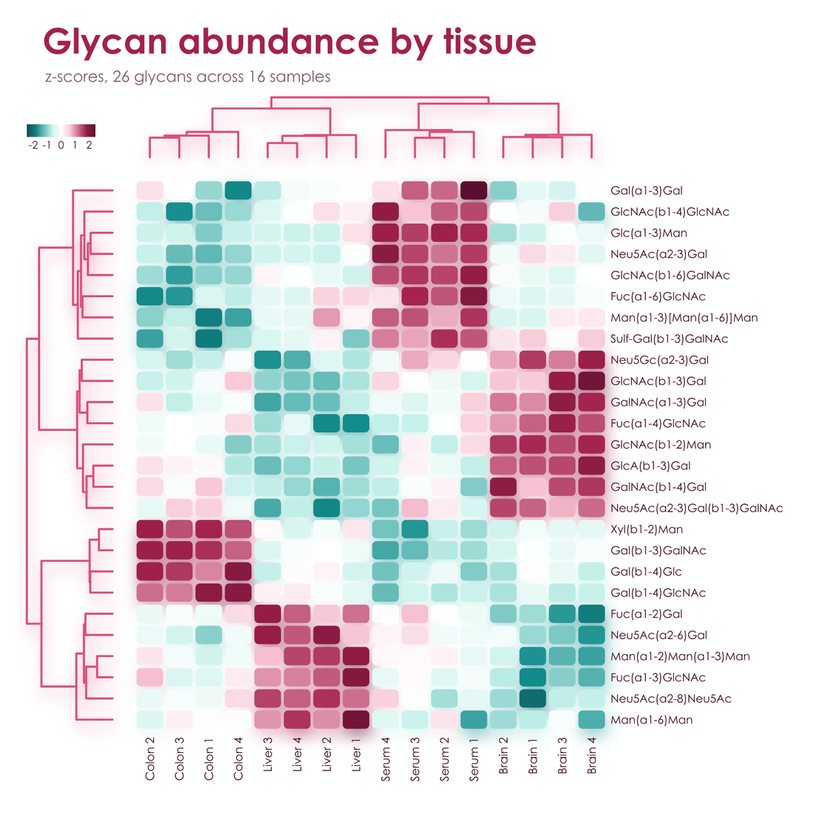</p>

| | |
|---|---|
| **Plots** | `plot`, `step`, `scatter`, `bar`, `barh`, `stacked_bar`, `hist`, `fill_between`, `errorbar`, `boxplot`, `violinplot`, `stripplot`, `contour`, `stem`, `hlines`, `vlines`, `arrow`, `rectangle`, `heatmap`, `ridgeline`, `dendrogram`, `axhline`, `axvline`, `axline`, `axhspan`, `axvspan`, `image`, and `vc.clustermap` |
| **Markers** | `o`, `s`, `D`, `^`, `v`, `>`, `<`, `X`, `P`, `*`, `h`, and `p`, all with the palette's effects |
| **Annotation** | `text`, `annotate`, `legend`, and `colorbar`, with `_{sub}` and `^{super}` in any text; `annotate(spread = True)` names line ends directly, moving labels apart exactly as little as it takes, with a hairline to each one that moved |
| **Pages** | `vc.Figure(183, 120, unit = 'mm')` is a journal page, `fig.add_axes((x, y, w, h), unit = 'mm')` places a panel from its top left, and `fig.letter(x, y, 'a', 'Heading')` and `fig.text` write panel letters and any other text on the page; `vc.subplot_mosaic('abc;ddd')` lets axes span cells of a grid |
| **Axes** | `set_xscale` takes `linear`, `log`, `sqrt`, or any pair of functions; `fmt` on `set_xticks` and `set_yticks` writes the ticks, as `'{:.0%}'` or a function; `tick_params` sets each axis's tick length, pad, label size, and labels, puts x labels on top, or keeps labels exactly as set; `emphasis` sets chosen tick labels bold in a color; `set_spines` shows or hides each axis line |
| **Layout** | Colliding tick labels turn and thin themselves, labels move to the side with room, legends wrap, long axis names shrink, and the page grows for anything that needs it; `vc.subplots(sharex = True, sharey = 'row')` shares limits, scales, and ticks across all panels, rows, or columns, as in matplotlib |
| **Output** | `fig.save` writes PNG, PDF, or SVG from the same geometry, with marks, gradients, and text as real vectors in PDF and SVG; `fig.to_rgba` gives the pixels and `fig.display_list` the drawing operations, for showing a figure in a window |
| **Positions** | `fig.layout` settles the page, and `ax.page` and `ax.data` turn data positions into page points and back, and `ax.boxes()` gives the page boxes of everything drawn, for placing things yourself clear of it or answering a mouse |
| **Display** | `fig.show()` works inline in Jupyter and slate, and in the system's image viewer from a terminal, with CI and coding agents kept silent |
| **SVG hooks** | `gid` on `arrow` and `scatter` names elements for hover text and scripting |
| **Names** | `names` on `scatter` labels each point, and on `heatmap` each row and column, which draws nothing but lets slate show what is under the mouse |
| **Palettes** | `fig.in_palette('aura')` gives the same figure in another palette, exactly as if it had been drawn in that one |
| **State** | None hidden: a figure is an object, with no current figure and nothing to close |

## Light and quick

No compiled plotting stack, no backends, and no font cache. For vector output, viscose is often many times faster than
matplotlib and seaborn, and its files can be far smaller. At 300 dpi, in Poster:

| | matplotlib and seaborn | viscose |
|---|---|---|
| Dependencies | Nine extra packages, 42.5 MB | numpy and glycorender, with 0.15 MB of its own code |
| Clustermap, 300 x 100, PDF | 1.57 s, 587 kB | **0.02 s, 79 kB** |
| Clustermap, 300 x 100, SVG | 1.40 s, 5,943 kB | **0.02 s, 182 kB** |
| Clustermap, 26 x 16, PDF | 0.11 s, 22 kB | **0.02 s**, 26 kB |
| Three lines with a legend, PDF | 0.03 s, 12 kB | **under 0.01 s**, 13 kB |
| Scatter, 100,000 points, PDF | 0.96 s, 1,524 kB | **0.19 s, 644 kB** |
| Bars, PNG | 0.19 s, 43 kB | **0.20 s, 38 kB** |
| Three lines with a legend, PNG | 0.27 s, 393 kB | 0.43 s, **370 kB** |
| Scatter, 412 points, PNG | 0.23 s, 147 kB | 0.27 s, 180 kB |

PNGs keep pace with matplotlib's compiled rasterizer, at most about 1.6 times its time in Poster, and pack smaller wherever a plot
has fills and lines. The soft shadows of Lumen and Aura are computed while the page draws. To rerun the full comparison, wins and losses alike, use
[benchmarks/compare_matplotlib.py](https://github.com/BojarLab/viscose/blob/main/benchmarks/compare_matplotlib.py).

## Make it yours

`vc.set_palette('aura')` changes the default for every figure, and `vc.set_palette(None)` hands the choice back. A library that builds on viscose calls `vc.default_palette('aura')`
instead, which gives way to the choice of whoever uses it. In any palette, refer to its shades as `a0` to `a3` and `b0` to `b3`, dark
to pale, or as `ink`, `muted`, `faint`, and `paper`; hex and CSS color names work too. `fig.pal.groups(3, 2)` gives categories grouped by hue,
here three shades of one and two of the other, and `fig.pal.contrast(n)` alternates between the hues for categories that have to stand
apart, as `scatter(hue = ...)` does.

A palette of your own is two hues, three text colors, and whichever effects you like:

```python
vc.register_palette(vc.Palette('midnight', ['#14213D', '#27477E', '#5C85C5', '#C4D5EE'], ['#8F5B00', '#D08C00', '#F2B83B', '#FBE5B0'],
                               '#14213D', '#5A6478', '#E6EAF1', point = 'sphere', bar = 'deep', shadow = 0.4))
fig, ax = vc.subplots(palette = 'midnight')
```

A palette can also bring a house or journal font (`font = ('Arial', 'arial.ttf', 'arialbd.ttf')`), a true minus sign (`minus = '−'`), `spacing` that tightens every gap, pad, and legend row for six-point type, and color scales of its own (`sequential_stops`, `diverging_stops`), so a journal's figure style is one palette.

A palette's `paper` is the color of its page, white unless you say otherwise, and every format draws on it. For a dark page, give it a light
`ink` and order its shades from the strongest against the page to the faintest, so that rings, halos, and scales follow.

Century Gothic is used where it is installed, and glycorender's bundled Comfortaa elsewhere.

## More

[examples/gallery.py](https://github.com/BojarLab/viscose/blob/main/examples/gallery.py) draws eight standard figures in every palette, [examples/features.py](https://github.com/BojarLab/viscose/blob/main/examples/features.py)
draws one sheet of features per palette, and [examples/readme_figures.py](https://github.com/BojarLab/viscose/blob/main/examples/readme_figures.py) draws every image on this page.
